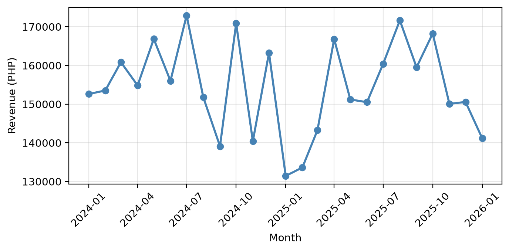
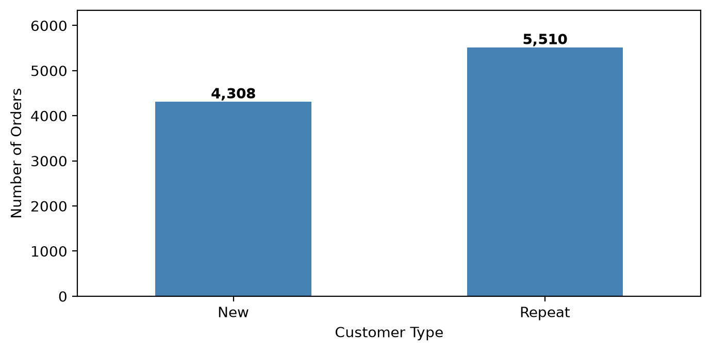
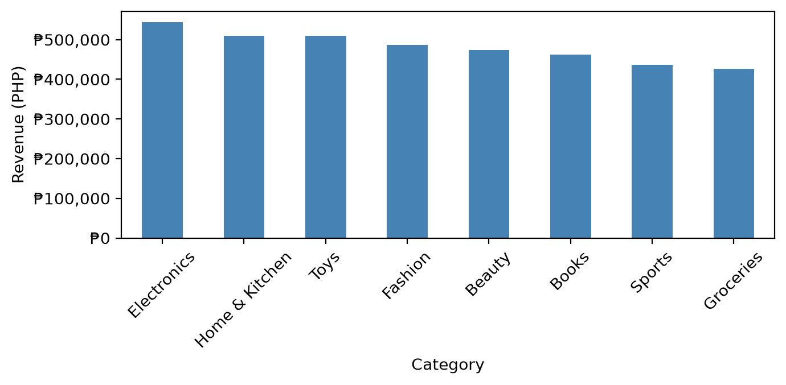
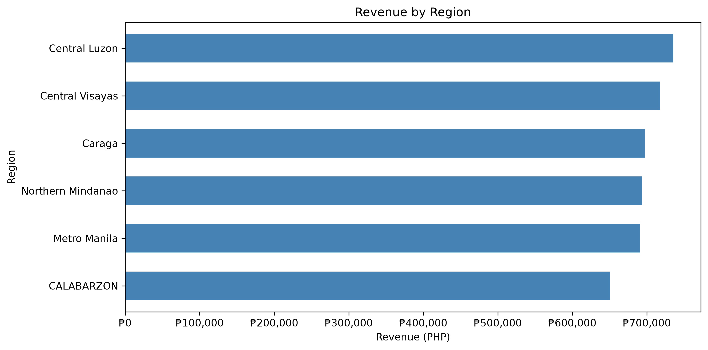
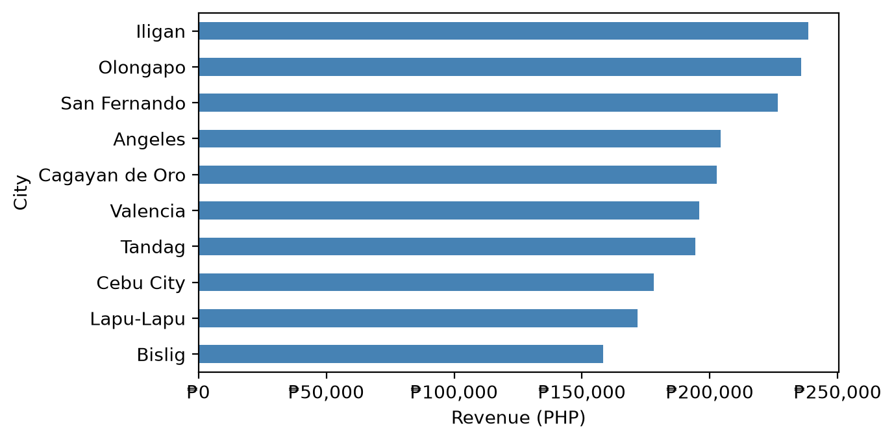
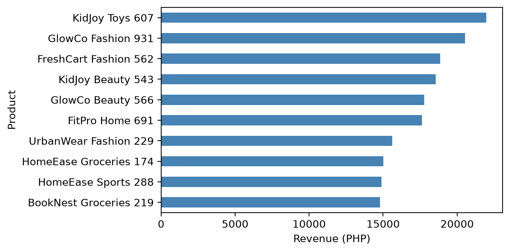

# Retail Sales Performance Analysis | Python Capstone Project

A data analytics capstone examining retail sales, customer purchasing patterns, product performance, and geographic revenue distribution in the Philippines. The project combines data cleaning in **Python/Pandas** with six reproducible sales visualizations to identify actionable business opportunities.

## Executive Summary

- The reported analysis covers **9,850 completed orders** and **₱3,861,540.04 in net revenue**.
- Reported **average order value (AOV)** is **₱392.03**.
- Net revenue reflects discounts rather than undiscounted gross sales.
- Monthly revenue varies substantially, suggesting demand and/or sales-mix fluctuations.
- **Electronics** leads the displayed product-category revenue ranking; **Home & Kitchen** and **Toys** follow closely.
- **KidJoy Toys 607** is the highest-revenue individual product in the displayed top-ten ranking.
- **Central Luzon** has the highest revenue among the six displayed regions.
- **Iligan** ranks first among the displayed top-ten cities by revenue.
- There are **5,510 repeat-customer orders** versus **4,308 new-customer orders** in the customer-type chart.
- Repeat orders account for approximately **56.1% of the 9,818 classified orders**.
- Priorities include customer retention, demand forecasting, inventory planning, and discount analysis.

> **Data consistency note:** The customer-type chart totals **9,818** orders, which is **32 fewer** than the reported **9,850** completed orders. Confirm whether these orders have missing customer classifications or were excluded by a filter. The supplied executive summary calls Toys a leading category, but the exported category chart ranks Electronics first. This README follows the chart for the category ranking.

## One-Page Insights Summary

### Business performance

| Metric | Result | Interpretation |
|---|---:|---|
| Net revenue | ₱3,861,540.04 | Reported sales after discounts |
| Completed orders | 9,850 | Reported completed-order volume |
| Average order value | ₱392.03 | Reported average spend per completed order |
| New-customer orders | 4,308 | Orders classified as new |
| Repeat-customer orders | 5,510 | Orders classified as repeat |
| Repeat share of classified orders | 56.1% | Repeat business is a major contributor to order volume |

### Five key findings

**1. Revenue changes month to month.** The monthly trend chart shows a variable revenue pattern across **January 2024–January 2026**, with several peaks around ₱170,000 and a trough near ₱130,000. This supports further analysis of seasonality, promotions, and sales drivers; it does not by itself prove a seasonal effect.

**2. Electronics leads category revenue.** In the exported category chart, Electronics is the largest category at roughly ₱545,000, followed by Home & Kitchen and Toys at roughly ₱510,000 each. Category figures here are approximate visual readings, not exact source-table aggregates.

**3. Regional sales are relatively close, but not identical.** Central Luzon leads the displayed regions at roughly ₱665,000; Central Visayas and Caraga follow. CALABARZON is lowest among the six shown, at roughly ₱605,000. Compare regional order counts and average order values before attributing differences to market demand.

**4. Repeat customers drive a majority of classified orders.** Repeat-customer orders (5,510) exceed new-customer orders (4,308) by **1,202**. These are order counts, not necessarily counts of unique customers or a cohort-based retention rate.

**5. Leading products and cities offer targeting opportunities.** KidJoy Toys 607 leads the top-products chart; Iligan leads the top-cities chart. Investigate product margins, stock availability, and city-level marketing effectiveness before reallocating resources.

### Recommendations

1. **Forecast and stock by demand:** Use monthly order and product-level sales trends to plan replenishment, especially for top-selling products; test forecasts against subsequent months.
2. **Segment and retain customers:** Analyze frequency, recency, and order value, then test loyalty offers for repeat buyers and second-purchase incentives for new buyers. Measure incremental revenue rather than only redemptions.
3. **Audit discounts and profitability:** Compare net revenue, discount rates, and product margins by category and region to identify profitable growth rather than revenue growth alone.

### Conclusion

The analysis shows a substantial base of repeat-order activity, differences across categories and locations, and meaningful monthly revenue variability. A practical next step is to validate order classifications and build repeatable reporting around revenue, order volume, AOV, and margins.

## Visualizations

### 1. Monthly revenue trend


### 2. New vs. repeat customer orders


### 3. Revenue by product category


### 4. Revenue by region


### 5. Top 10 cities by revenue


### 6. Top 10 products by revenue


## Data Analysis & Methodology

The Jupyter notebook (`YourNotebook.ipynb`) implements **data cleaning, sales-table construction, and six visualizations** using Python, Pandas, NumPy, and Matplotlib.

### 1. Clean and prepare the data

The notebook reads seven raw datasets (`customers.csv`, `products.csv`, `orders.csv`, `order_items.csv`, `payments.csv`, `returns.csv`, and `shipments.csv`) and writes their corresponding `cleaned_*.csv` files. Cleaning includes duplicate removal where applicable, standardized text categories, date parsing, and numeric conversions. The cleaned exports contain **5,000 customers, 800 products, 15,000 orders, 37,501 order items, 15,000 payments, 1,200 returns, and 15,000 shipments**. These are source-table row counts, not completed-order counts.

### 2. Build the sales analysis table

The notebook loads the cleaned **orders, order items, products, and customers** datasets, converts relevant fields to dates/numbers, and joins order items to orders, products, and customers using validated many-to-one merges. It checks that the resulting fact table retains the original number of order-item rows.

- **Gross item revenue:** `quantity * unit_price_at_purchase`
- **Discount-adjusted item revenue:** `gross_revenue * (1 - discount_pct.fillna(0))`
- **Sales scope:** only rows whose `order_status` is `Completed`
- **Reported AOV:** net revenue divided by the number of completed orders

The code treats missing discounts as **0%**, an explicit provisional assumption. The revenue measure does not incorporate shipping fees, refunds, returns, or product costs. The notebook's revenue calculations assume `discount_pct` is stored as a decimal fraction.

### 3. Generate six charts

1. **Monthly revenue trend:** aggregate discount-adjusted revenue by order month and plot a line chart.
2. **Top 10 products:** rank products by summed revenue and plot horizontal bars.
3. **Revenue by product category:** exclude missing and `Unknown` category labels and plot revenue by category.
4. **Revenue by region:** exclude missing and `Unknown` region labels and plot horizontal bars (regions on the y-axis).
5. **Top 10 cities:** exclude missing and `Unknown` city labels, rank by revenue, and plot horizontal bars (cities on the y-axis).
6. **New vs. repeat customer orders:** deduplicate completed sales by order ID, retain orders with customer IDs in the customer table, sort each customer's orders chronologically, and classify their **first observed completed order** as `New` and subsequent observed completed orders as `Repeat`.

The new/repeat chart describes order classifications **within the observed completed-order dataset**; it is not a count of unique new/repeat customers or a cohort retention rate. Its **9,818 classified orders** are **32 fewer than the 9,850 completed orders**; the reason should be validated against customer matching and filtering before reporting the difference as a confirmed data-quality issue.

The supplied project summary also describes a **Streamlit dashboard** with Year, Month, Region, Channel, and Category filters. Streamlit dashboard source code is not included in the supplied notebook or files, so the README does not present it as a runnable deliverable.

## Repository Files

```text
retail-sales-capstone/
├── README.md
├── ExecutiveSummary.txt
├── YourNotebook.ipynb
├── cleaned_customers.csv
├── cleaned_products.csv
├── cleaned_orders.csv
├── cleaned_order_items.csv
├── cleaned_payments.csv
├── cleaned_returns.csv
├── cleaned_shipments.csv
├── monthly_revenue_trend.png
├── new_vs_repeat_customer_orders.png
├── revenue_by_product_category.png
├── revenue_by_region.png
├── top_10_cities_by_revenue.png
└── top_10_products_by_revenue.png
```

## Tools and Technologies

- **Python / Jupyter Notebook:** data cleaning, analysis, and chart generation
- **Pandas:** reading CSVs, merging tables, filtering, aggregating, and customer classification
- **NumPy:** imported for numerical analysis
- **Matplotlib:** line charts and vertical/horizontal bar charts
- **Streamlit:** referenced in the executive summary; dashboard source is not included

## How to Run

1. Open `YourNotebook.ipynb` in Jupyter Notebook or JupyterLab.
2. Install the required packages: `pip install pandas numpy matplotlib jupyter`.
3. Place the **seven raw input CSV files** (`customers.csv`, `products.csv`, `orders.csv`, `order_items.csv`, `payments.csv`, `returns.csv`, and `shipments.csv`) in the notebook's working directory.
4. Run the cells in order. The notebook writes the cleaned datasets, loads four of them to build the sales fact table, and displays all six charts.
5. The included PNG files are static exports for quick viewing in GitHub. The notebook displays its plots with `plt.show()`; it does **not** automatically save them as PNG files.

**Reproducibility note:** The repository file list below contains the provided **cleaned** datasets. The raw input CSVs required for the notebook's cleaning cells were not among the supplied attachments. To execute every cell without changes, include those raw files separately. The notebook uses relative filenames, not machine-specific paths.

## Project Deliverables

- [x] Executive summary text
- [x] Jupyter notebook with data cleaning and six chart scripts
- [x] Cleaned customers CSV
- [x] Cleaned products CSV
- [x] Cleaned orders, order items, payments, returns, and shipments CSVs
- [x] Six exported PNG charts
- [x] One-page insights summary (included above)
- [x] GitHub-ready README

*Prepared from the supplied executive summary, Jupyter analysis notebook, seven cleaned datasets, and six chart images. Approximate chart values are identified as such.*
